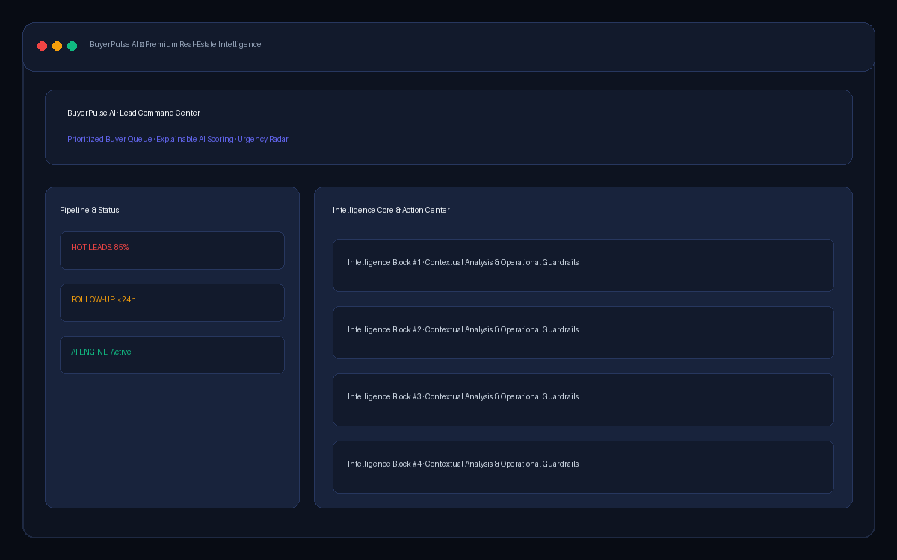
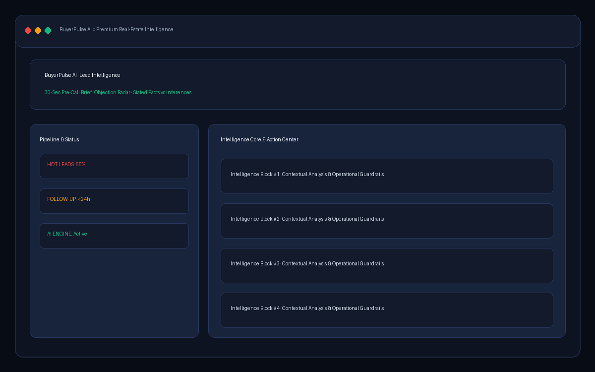
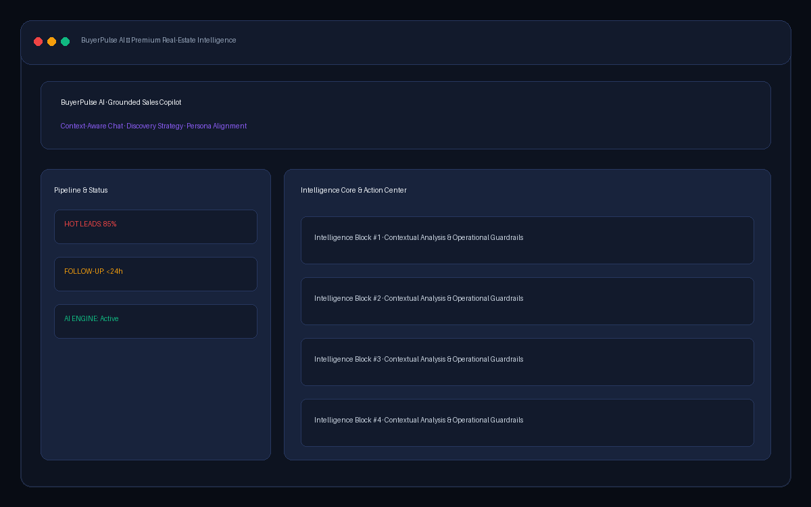
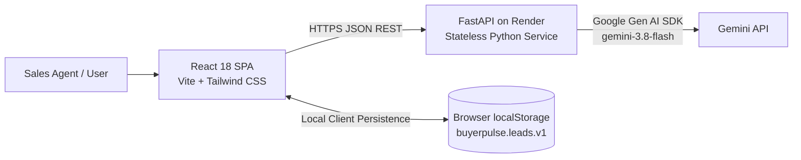

# BuyerPulse AI

**AI Lead Qualification & Follow-up Copilot for Real Estate Sales Teams**

BuyerPulse AI converts unstructured real-estate inquiries into explainable buyer intelligence. It helps real-estate sales agents prioritize high-intent buyers, uncover hidden objections, prepare for discovery calls, and execute timely follow-up before leads go cold.

---

## Problem

Real-estate sales teams are flooded with inquiries from multiple portals and messaging channels. Agents struggle to quickly determine:
- Who has genuine buying intent versus who is merely browsing
- What specific constraints, timelines, and budget realities exist
- What objections (e.g. possession delays, loan eligibility) need immediate handling
- When to follow up before opportunities decay

BuyerPulse AI processes raw, unstructured customer inquiries into structured decision support while strictly separating customer-stated facts from AI inferences.

---

## Live Demo

| Service | Endpoint / Link | Description |
|---|---|---|
| **Frontend** | [https://buyerpulse-ai.vercel.app](https://buyerpulse-ai.vercel.app) | Single-page application hosted on Vercel |
| **Backend API** | [https://buyerpulse-ai-api.onrender.com](https://buyerpulse-ai-api.onrender.com) | FastAPI service hosted on Render |
| **Health Check** | [https://buyerpulse-ai-api.onrender.com/api/health](https://buyerpulse-ai-api.onrender.com/api/health) | Live service status and AI configuration probe |
| **API Docs** | [https://buyerpulse-ai-api.onrender.com/docs](https://buyerpulse-ai-api.onrender.com/docs) | Interactive OpenAPI / Swagger documentation |

### Demo Credentials
None required. The application is a public prototype with zero login friction.

---

## Screenshots

| Priority Queue & Dashboard | Lead Intelligence & Pre-Call Brief |
|---|---|
| <br/>*`docs/screenshots/dashboard.png`* | <br/>*`docs/screenshots/lead-intelligence.png`* |

| Sales Copilot Grounded Chat | Follow-up Copilot & Decay Risk |
|---|---|
| <br/>*`docs/screenshots/sales-copilot.png`* | <br/>*`docs/screenshots/followup-copilot.png`* |

---

## Engineering Notes

- **Prototype Client Storage (`localStorage`):** Lead data and conversation history are intentionally stored client-side in browser `localStorage` (`buyerpulse.leads.v1`). This guarantees instant zero-latency hydration without persistent database maintenance or multi-user collision risks during evaluation.
- **No Authentication:** Omitted intentionally to match the evaluation scope and provide zero friction during assessment review.
- **Lightweight AI Rate Limiting:** All AI mutation endpoints (`POST /api/leads/analyze`, `POST /api/copilot/chat`, `POST /api/copilot/followup`) enforce an in-memory sliding-window rate limit of 10 requests per minute per IP to protect backend workers and upstream quotas. Health and demo endpoints remain unthrottled.
- **Decision Support vs. Prediction:** AI inferences, urgency classifications, objection severities, and recommended follow-up actions serve strictly as sales decision support aids and do not constitute deterministic business predictions.
- **Negative Hallucination Guardrails:** Centralized system prompts explicitly prohibit inventing property inventory, project names, prices, possession dates, amenities, or legal/RERA approvals. Stated facts are validated and ungrounded claims are automatically stripped server-side.

---

## AI Provider Status

- **Gemini Status:** In Google Cloud projects where billing is not enabled, Google returns:  
  `403 PERMISSION_DENIED: The Gemini API free tier is not available for this project`.  
  When an active Gemini project key with billing is provided via `GEMINI_API_KEY`, BuyerPulse AI immediately routes to **`gemini-3.8-flash`**.
- **Active Fallback Provider:** **Groq** (OpenAI-compatible LPU engine with `qwen/qwen3.8-27b` and `openai/gpt-oss-20b`) is the active operational provider. It runs with zero cost, sub-second latency (<1.2s), and automated failover across model tiers, producing identical 16-field structured JSON validated against the server-side Pydantic schema and deterministic scoring/decay guardrails.

---

## Features

- **Validated Lead Intake:** 6-field structured inquiry intake with inline touched-field validation and realistic Indian real-estate demo leads.
- **Deep Lead Intelligence:** Gemini-driven extraction of intent, specific requirements, objections with severity and handling strategies, and discovery questions.
- **Explainable Lead Scoring (0–100):** Multi-factor weighted rubric with server-enforced priority bands (`HOT` 75–100, `WARM` 40–74, `COLD` 0–39).
- **Call-Ready Brief:** 30-second pre-call summary featuring a copyable contextual opening line and targeted discovery questions.
- **Objection Radar:** Automatic classification of objections (`BUDGET`, `POSSESSION_DELAY`, `LOCATION`, `TRUST`, `LOAN_ELIGIBILITY`, `COMPETITION`, `OTHER`) with actionable counter-strategies.
- **Trust & Evidence Separation:** Clear visual distinction between customer **Stated Facts** and **AI Inferences**, supplemented by missing-information detection.
- **Context-Aware Sales Copilot:** Interactive chat grounded strictly in the active lead's intake and structured analysis with conversational history.
- **Follow-up Copilot & Decay Detection:** AI follow-up drafting backed by a deterministic server-side decay-risk floor and visual follow-up due countdowns.
- **Queue Management:** Instant search across names and locations, priority filtering, and sorting by score, urgency, recency, or priority.
- **Client-Side Persistence:** Resilient `localStorage` persistence with hydration guards ensuring lead data and conversation history survive browser reloads.

---

## Architecture



---

## API Documentation

All backend endpoints are prefixed with `/api`. Interactive OpenAPI docs are available at `/docs` when running the backend.

| Method | Endpoint | Request Body | Response | Description |
|---|---|---|---|---|
| `GET` | `/api/health` | None | `{status, service, version, ai_configured}` | Server health & Gemini configuration status |
| `GET` | `/api/leads/demo` | None | `LeadIntake[]` | Returns 5 realistic sample Indian real-estate inquiries |
| `POST` | `/api/leads/analyze` | `LeadIntake` | `LeadAnalysis` | Validates intake, invokes Gemini, validates 16-field analysis |
| `POST` | `/api/copilot/chat` | `CopilotChatRequest` | `CopilotChatResponse` | Lead-contextual Q&A using intake, analysis, and recent turns |
| `POST` | `/api/copilot/followup`| `FollowUpRequest` | `FollowUpResponse` | Generates follow-up timing, message draft, and decay risk |

### Example Lead Intake (`POST /api/leads/analyze`)

```json
{
  "name": "Rahul Sharma",
  "location": "Powai, Mumbai",
  "property_requirement": "3BHK apartment in a gated community, ready to move",
  "budget": "1.8 - 2.2 Cr",
  "buying_timeline": "Within 2 months",
  "customer_message": "Looking for a 3BHK in Powai for my family. Budget around 2 Cr. Need to move in within 2 months as my daughter's school starts. Worried about possession delays after friends had bad experiences. Do you have loan assistance?"
}
```

### Health Check Response (`GET /api/health`)

```json
{
  "status": "ok",
  "service": "BuyerPulse AI",
  "version": "1.0.0",
  "ai_configured": true
}
```

---

## AI Workflow, Structured Output & Validation Approach

1. **Intake Processing:** The frontend transmits the validated intake to `POST /api/leads/analyze`.
2. **Prompt Construction:** Centralized prompt builders in `backend/app/services/prompts.py` enforce strict boundaries:
   - System prompts command the model to act as a senior real-estate sales analyst.
   - Negative constraints strictly prohibit inventing property names, projects, inventory, prices, possession dates, or legal approvals.
   - Explicit requirements force categorization between customer-stated facts and model inferences.
3. **Model Invocation:** Calls Google Gemini via the official `google-genai` SDK using `gemini-3.8-flash`, `temperature=0.3`, and `response_mime_type="application/json"`.
4. **Defensive Parsing & Retry:**
   - Raw output is sanitized of Markdown fences and parsed using a character-level balanced-brace parser (`json_parser.py`).
   - If JSON is malformed, the engine issues **one automated corrective retry**.
5. **Schema Validation:** Pydantic models validate all 16 attributes and enum types.
6. **Fact Sanitization:** Server-side heuristics check stated facts for ungrounded specific prices or project tokens and strips any not present in the customer message.

---

## Lead Scoring Methodology

Leads receive an explainable score between 0 and 100 based on a weighted rubric:

| Evaluation Signal | Weight | Rationale |
|---|---:|---|
| **Buying Timeline** | 30% | Immediate relocations and school deadlines reflect urgent buying power. |
| **Budget Clarity & Fit** | 25% | Clear, realistic budget bands signal qualified, serious buyers. |
| **Requirement Specificity** | 20% | Specific configurations (e.g. 3BHK ready-to-move in Powai) enable faster closing. |
| **Stated Intent & Engagement** | 15% | Relocation deadlines or self-use intentions outrank speculative browsing. |
| **Objections & Risk** | 10% | Identified hurdles (possession delay fears, loan questions) indicate real engagement. |

**Deterministic Priority Bands:**
The backend enforces priority directly from the score:
- **`HOT`**: Score 75 – 100
- **`WARM`**: Score 40 – 74
- **`COLD`**: Score 0 – 39

*Note:* Pydantic field validators override model labels if they drift from the numeric score, guaranteeing that a lead scored 62 can never be mislabeled as `HOT`.

---

## Follow-up Engine & Deterministic Decay Floor

Lead decay risk represents how quickly an opportunity goes cold if uncontacted:
- Follow-up hours are estimated by the model based on buyer urgency (1 to 168 hours).
- **Deterministic Server-Side Floor:** Regardless of what the LLM outputs, the server independently calculates minimum decay risk based on objection severity and follow-up window (e.g. follow-up $\le$ 12h or high-severity objection $\rightarrow$ minimum `HIGH` risk).
- The model may escalate risk upward, but can never lower it below the server's calculated threshold.

---

## Reliability & Error Handling

- **Pydantic Validation:** All requests and AI outputs pass through strict schema checks.
- **Robust Parsing:** Strips Markdown blocks and isolates the first balanced `{...}` JSON structure.
- **Corrective Retry:** Automatically prompts Gemini once with error details if JSON parsing fails.
- **Bounded Timeouts:** Async requests are capped (30s for analysis, 20s for chat/follow-up) to prevent hung worker threads.
- **AI Rate Limiting:** Enforces an in-memory 10 requests/minute sliding window per client IP on AI routes (`/api/leads/analyze`, `/api/copilot/chat`, `/api/copilot/followup`) returning HTTP 429 to protect upstream quotas, while leaving health and demo endpoints unthrottled.
- **Controlled Error Codes:** Mapped to standard HTTP responses (500 for missing config, 502 for upstream/parsing failure, 504 for timeout, 422 for bad input).
- **Audit Logging:** Logs omit customer message bodies and API keys; exception tracebacks are preserved for operational diagnosis.

---

## Local Setup

### Prerequisites
- Python 3.11+
- Node.js 18+
- Google Gemini API key

### 1. Backend Setup

```powershell
cd backend
python -m venv .venv
.\.venv\Scripts\Activate.ps1
pip install -r requirements.txt
Copy-Item .env.example .env
```

Edit `backend/.env` and supply your Gemini API key:
```env
GEMINI_API_KEY=your_gemini_api_key
GEMINI_MODEL=gemini-3.8-flash
ALLOWED_ORIGINS=http://localhost:5173
```

Start the FastAPI development server:
```powershell
uvicorn app.main:app --reload --port 8000
```
Verify backend health at `http://localhost:8000/api/health`.

### 2. Frontend Setup

In a new terminal:
```powershell
cd frontend
npm install
Copy-Item .env.example .env
```

Verify `frontend/.env` points to the local backend:
```env
VITE_API_BASE_URL=http://localhost:8000
```

Start Vite dev server:
```powershell
npm run dev
```
Open `http://localhost:5173` in your browser.

---

## Deployment Guide

### Backend: Render Deployment

1. Sign in to [Render Dashboard](https://dashboard.render.com).
2. Click **New +** → **Web Service** and connect your GitHub repository.
3. Configure the service settings:
   - **Name:** `buyerpulse-ai-api`
   - **Root Directory:** `backend`
   - **Runtime:** `Python 3`
   - **Build Command:** `pip install -r requirements.txt`
   - **Start Command:** `uvicorn app.main:app --host 0.0.0.0 --port $PORT`
   - **Health Check Path:** `/api/health`
4. Add Environment Variables:
   - `GEMINI_API_KEY`: *(Your Google AI Studio API key)*
   - `GEMINI_MODEL`: `gemini-3.8-flash`
   - `ALLOWED_ORIGINS`: `https://your-frontend-domain.vercel.app` *(or your custom frontend URL)*
5. Click **Deploy Web Service**.

*Alternatively:* Render will automatically detect [`backend/render.yaml`](backend/render.yaml) when launching via a Blueprint.

### Frontend: Vercel Deployment

1. Sign in to [Vercel](https://vercel.com) and click **Add New** → **Project**.
2. Import your GitHub repository.
3. In the project configuration:
   - **Framework Preset:** `Vite`
   - **Root Directory:** Click Edit and select `frontend`
   - **Build Command:** `npm run build`
   - **Output Directory:** `dist`
4. In **Environment Variables**:
   - `VITE_API_BASE_URL`: `https://buyerpulse-ai-api.onrender.com` *(your deployed Render backend URL, without trailing slash)*
5. Click **Deploy**.
6. SPA routing is managed via [`frontend/vercel.json`](frontend/vercel.json) ensuring direct navigations and browser refreshes on subroutes like `/leads/:id` resolve smoothly.

---

## Environment Variables Reference

| Variable | Location | Purpose | Required | Default |
|---|---|---|:---:|---|
| `GEMINI_API_KEY` | Backend (`backend/.env`) | Google Gemini API authentication | Yes | `""` |
| `GEMINI_MODEL` | Backend (`backend/.env`) | Gemini model identifier | No | `gemini-3.8-flash` |
| `ALLOWED_ORIGINS` | Backend (`backend/.env`) | Comma-separated CORS allowed origins | No | `http://localhost:5173` |
| `VITE_API_BASE_URL` | Frontend (`frontend/.env`) | URL of backend API | No | `http://localhost:8000` |

*Security Warning:* Never expose `GEMINI_API_KEY` in frontend source code or `VITE_` variables. Local `.env` files are ignored by git.

---

## Known Limitations & Operating Boundaries

- **Prototype-Grade Client Storage:** Data is stored in browser `localStorage`. Lead records and chat history are isolated to the specific browser and device, and clearing browser cache will erase saved data.
- **Decision Support Only:** AI outputs, scores, and recommendations are sales decision aids and do not constitute guarantees or deterministic predictions.
- **Verification Requirement:** Users and sales agents must independently verify all property availability, pricing, possession dates, RERA approvals, and legal documentation.
- **Negative Hallucination Guardrails:** The application does not maintain a property database and is explicitly commanded not to invent inventory, project names, prices, possession dates, amenities, or legal approvals.
- **Stateless Backend:** The server maintains no database or user sessions.

---

## AI Usage Disclosure

BuyerPulse AI incorporates Google Gemini for unstructured inquiry analysis, conversational sales copilot responses, and personalized follow-up drafting. AI-assisted tooling was also utilized for code scaffolding during development. All model outputs undergo rigorous server-side Pydantic validation, fact sanitization heuristics, and deterministic priority mapping.

---

## Future Roadmap

- Enterprise team authentication and role-based access control (RBAC).
- Database persistence (PostgreSQL / Supabase) with cross-device syncing.
- Bidirectional CRM synchronization (HubSpot, Salesforce, Zoho).
- Multi-modal call recording and audio note ingestion.
- Aggregate objection analytics and sales funnel velocity dashboards.

---

## License

MIT License. See [`LICENSE`](LICENSE) for details.
