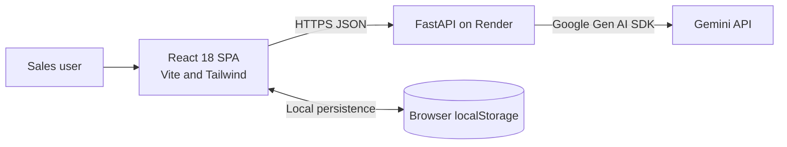

# BuyerPulse AI

**AI Lead Qualification & Follow-up Copilot for Real Estate Sales Teams**

BuyerPulse AI converts unstructured real-estate inquiries into explainable buyer intelligence. It helps salespeople prioritize high-intent buyers, understand objections, prepare for calls, and follow up before opportunities go cold.

## Problem

Real-estate sales teams receive many inquiries and need to quickly decide who to contact, what to ask, how to handle objections, and when to follow up. BuyerPulse AI structures each inquiry into a concise decision aid while separating customer-stated facts from model inferences.

## Live demo

- Frontend: _Add the Vercel URL after deployment._
- Backend: _Add the Render URL after deployment._

## Demo credentials

None required. The prototype has no authentication.

## Screenshots

Add screenshots here after capturing the running app:

- Dashboard and priority queue
- Lead intelligence and call-ready brief
- Sales Copilot
- Follow-up Intelligence

## Features

- Validated lead intake with realistic demo leads
- Gemini analysis with score rationale, objections, evidence, and discovery questions
- Search, filter, and sort across leads, with browser localStorage persistence
- Call-ready brief and objection-handling guidance for each lead
- Context-aware Sales Copilot with conversation history per lead
- Follow-up generation with deterministic decay-risk floor and a due indicator
- Copyable response and follow-up drafts
- Responsive dashboard layout and AI/API error states

## Architecture



## API

| Method | Path | Purpose |
|---|---|---|
| `GET` | `/api/health` | Service version and AI configuration status |
| `GET` | `/api/leads/demo` | Five sample Indian real-estate leads |
| `POST` | `/api/leads/analyze` | Validate an intake and return structured analysis |
| `POST` | `/api/copilot/chat` | Answer a question using one lead and recent chat context |
| `POST` | `/api/copilot/followup` | Generate a follow-up plan and decay-risk level |

### Example intake

```json
{
  "name": "Rahul Sharma",
  "location": "Powai, Mumbai",
  "property_requirement": "3BHK ready-to-move",
  "budget": "1.8 - 2.2 Cr",
  "buying_timeline": "Within 2 months",
  "customer_message": "Looking for a 3BHK in Powai, budget around 2 Cr, and need to move in within 2 months. I am worried about possession delays."
}
```

The analysis response schema is defined in [`backend/app/schemas.py`](backend/app/schemas.py). FastAPI's interactive API docs are available at `/docs` when the backend is running.

### Health response

`GET /api/health` returns the service name, version, and whether the server has a Gemini key configured:

```json
{
  "status": "ok",
  "service": "BuyerPulse AI",
  "version": "1.0.0",
  "ai_configured": true
}
```

## AI workflow

The browser sends intake to FastAPI. The backend builds a prompt from `backend/app/services/prompts.py`, calls Gemini through the official Google Gen AI SDK, parses JSON, validates the result with Pydantic, and returns only the structured response. The API key stays on the backend. Chat and follow-up prompts receive the selected lead's intake, analysis, and relevant history.

## Lead scoring

The model scores each lead from 0 to 100 using these weighted signals:

| Signal | Weight |
|---|---:|
| Buying timeline | 30% |
| Budget clarity and fit | 25% |
| Requirement specificity | 20% |
| Stated intent and engagement | 15% |
| Objections and risk | 10% |

The server derives priority from the score: 75–100 is HOT, 40–74 is WARM, and 0–39 is COLD.

## Prompt design

Prompts specify the role, permitted evidence, required fields, allowed enums, and output format. They tell the model to separate stated facts from inferences, identify missing information, and avoid inventing inventory, prices, project names, possession dates, or legal approvals.

## Reliability and error handling

- Pydantic validates all request and response shapes.
- The JSON parser removes Markdown fences and extracts a balanced JSON object.
- Malformed JSON gets one corrective retry; invalid schemas return a controlled error.
- Gemini calls have timeouts. API errors return clear 500, 502, or 504 responses.
- Decay risk has a deterministic server-side floor; AI may escalate it but cannot lower it.
- Logs omit API keys and customer message bodies.
- If analysis fails, the frontend retains the lead and offers a retry.

## Local setup

### Backend

```powershell
cd backend
python -m venv .venv
.\.venv\Scripts\Activate.ps1
pip install -r requirements.txt
Copy-Item .env.example .env
# Set GEMINI_API_KEY in backend/.env
uvicorn app.main:app --reload --port 8000
```

### Frontend

In another terminal:

```powershell
cd frontend
npm install
Copy-Item .env.example .env
npm run dev
```

Open `http://localhost:5173`. The frontend uses `VITE_API_BASE_URL` to find the backend.

## Deployment

### Render backend

Create a Web Service from the repository and set the root directory to `backend`. The included `backend/render.yaml` describes the service. Add `GEMINI_API_KEY`, `GEMINI_MODEL`, and `ALLOWED_ORIGINS` in Render's environment settings. Set `ALLOWED_ORIGINS` to the deployed Vercel origin.

### Vercel frontend

Import the repository with `frontend` as the root directory. Set `VITE_API_BASE_URL` to the deployed Render service URL, then deploy.

## Environment variables

| Variable | Where | Purpose |
|---|---|---|
| `GEMINI_API_KEY` | Backend only | Gemini authentication |
| `GEMINI_MODEL` | Backend | Model identifier; defaults to `gemini-3.8-flash` |
| `ALLOWED_ORIGINS` | Backend | Comma-separated browser origins allowed by CORS |
| `VITE_API_BASE_URL` | Frontend | Backend base URL; defaults to `http://localhost:8000` |

Never place `GEMINI_API_KEY` in a `VITE_` variable or frontend source. Local `.env` files are ignored by Git.

## Known limitations

- **localStorage is prototype-grade** and is not shared across users or devices; clearing browser storage removes saved leads.
- **AI outputs are decision support** and require human verification before acting.
- **The application does not verify real property availability, pricing, or legal documentation.**
- There is no authentication or server-side lead storage; do not use real customer PII in a public deployment.
- Live demo links and screenshots are placeholders until deployment and capture are complete.

## AI usage disclosure

BuyerPulse AI uses Google Gemini for lead analysis, copilot answers, and follow-up drafting. The project also used AI-assisted scaffolding during development. Structured outputs are validated by the backend, and score bands are enforced server-side.

## Future roadmap

- Authentication and team-scoped persistence
- CRM integrations such as HubSpot or Salesforce
- Call-note ingestion
- Team-level objection trends and operational observability

## Quick QA checklist

- Confirm `/api/health` reports the service name, version, and AI configuration state.
- Confirm `/api/leads/demo` returns five demo leads.
- Submit an intake and verify the score band matches the returned priority.
- Load demo leads, sort and filter the queue, and open a lead's intelligence panel.
- Ask the Sales Copilot a question and confirm the context indicator names the selected lead.
- Generate a follow-up, copy its message, and verify the due indicator after the follow-up window passes.
- Refresh the browser and confirm leads and chat history remain in localStorage.
- Check the dashboard at a narrow mobile viewport and confirm there is no horizontal overflow.

## License

MIT. See [`LICENSE`](LICENSE).
