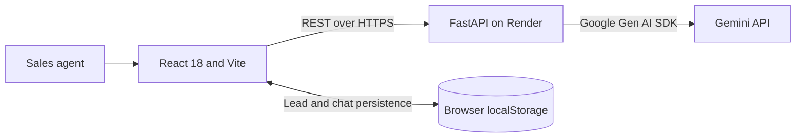

# BuyerPulse AI — Architecture

BuyerPulse AI is a browser-based React application backed by a stateless FastAPI service. Lead records and per-lead chat history live in the user's browser; the backend does not store leads.

## Request lifecycle

1. The frontend validates intake and submits it to `POST /api/leads/analyze`.
2. FastAPI validates fields with Pydantic and calls the analysis service.
3. The Gemini client sends a bounded prompt and expects JSON output.
4. The parser extracts a JSON object; Pydantic validates the response schema and priority threshold.
5. The backend filters suspicious unsupported specifics from stated facts and returns the analysis.
6. The frontend persists intake, analysis, activity, and follow-up state in localStorage.

Copilot chat and follow-up requests send the selected lead and its structured analysis to the backend. Chat includes recent turns. Each request is independent; there is no server session.

## Failure handling

| Failure | Behaviour |
|---|---|
| Missing Gemini key | Health reports `ai_configured: false`; AI endpoints return a clear configuration error |
| Malformed JSON | One corrective retry, then HTTP 502 |
| Invalid structured output | Controlled HTTP 502 response |
| Gemini timeout | HTTP 504 |
| Upstream failure | HTTP 502; logs include error type but not the customer message or key |
| Invalid intake | FastAPI returns validation details with HTTP 422 |
| localStorage unavailable or corrupted | The app falls back to an empty lead list or skips persistence |

## Deliberate boundaries

The app has no authentication, database, CRM integration, messaging integration, streaming, or RAG. The model receives only the selected lead context; the backend does not retain that data after the request.
